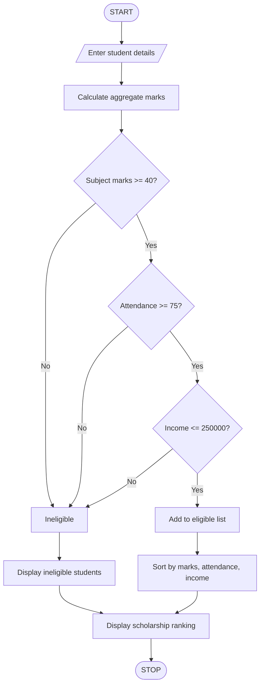

## 1. Problem Statement

Develop a Python program to allocate scholarships to students based on their academic performance and eligibility criteria.

The system should:

1. Accept student name, roll number, subject marks, attendance percentage, and family annual income.
2. Calculate aggregate marks.
3. Check minimum subject marks.
4. Check attendance eligibility (minimum 75%).
5. Check family income eligibility (below ₹2,50,000).
6. Identify eligible and ineligible students.
7. Rank eligible students based on aggregate marks.
8. Resolve ties using attendance percentage and then family income.
9. Display the final scholarship ranking list.

## 2. Algorithm

1. Start the program.
2. Read the number of students.
3. Enter each student's details.
4. Calculate total and aggregate marks.
5. Check whether each subject mark is at least 40.
6. Check attendance is at least 75%.
7. Check annual family income is at most ₹2,50,000.
8. If all conditions are satisfied, add the student to the eligible list.
9. Sort eligible students based on:
   - Highest aggregate marks.
   - Highest attendance.
   - Lowest family income.
10. Display eligible students in ranking order.
11. Display ineligible students.
12. Stop the program.


##3. Flowchart 


## 4. Sample Input

```
Enter number of students: 3

Enter Student Details
Student Name: Ravi
Roll Number: 101
Enter subject mark: 90
Enter subject mark: 85
Enter subject mark: 95
Enter attendance: 90
Enter family annual income: 200000

Enter Student Details
Student Name: Priya
Roll Number: 102
Enter subject mark: 95
Enter subject mark: 90
Enter subject mark: 95
Enter attendance: 95
Enter family annual income: 180000

Enter Student Details
Student Name: Kumar
Roll Number: 103
Enter subject mark: 35
Enter subject mark: 80
Enter subject mark: 75
Enter attendance: 85
Enter family annual income: 150000
```

## 5. Sample Output

```
--- SCHOLARSHIP RANKING ---

Rank: 1
Name: Priya
Roll Number: 102
Aggregate: 93.33333333333333
Attendance: 95.0
Income: 180000.0

Rank: 2
Name: Ravi
Roll Number: 101
Aggregate: 90.0
Attendance: 90.0
Income: 200000.0

--- INELIGIBLE STUDENTS ---
Kumar

Scholarship Allocation Completed
```


